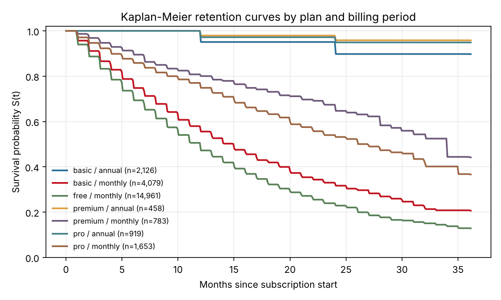
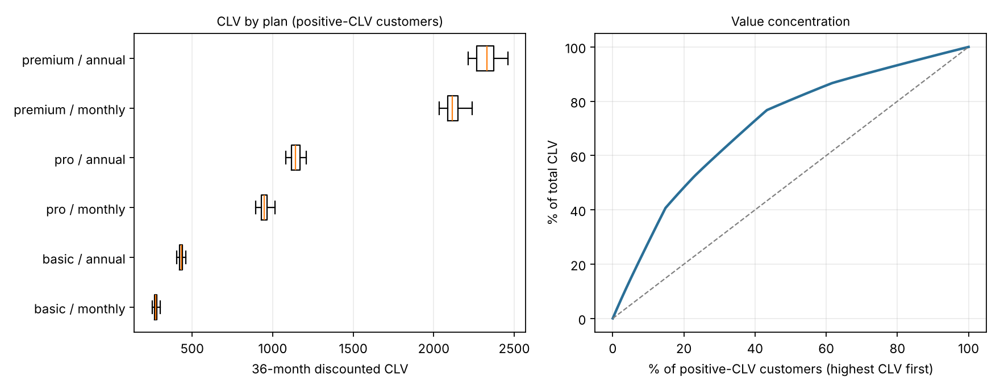
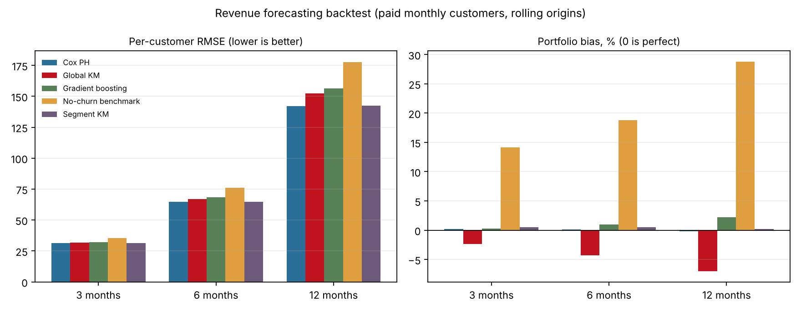
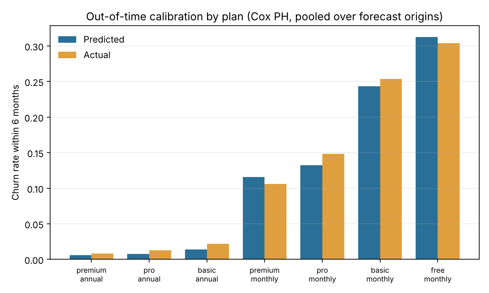
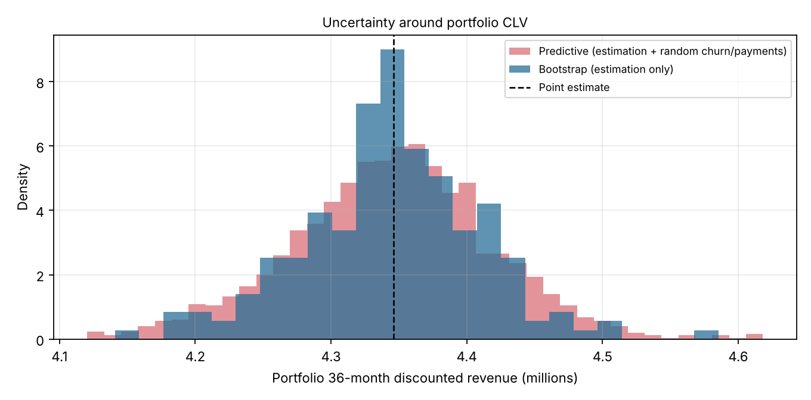

# CLV Toolkit - Results Report

_Generated automatically by `run_pipeline.py`. Every number below is reproduced from the raw CSVs._

> **Read this first.** The dataset is synthetic. All findings describe how the methods behave on this dataset; they do not establish performance on real subscription businesses.

## 1. Data audit and data-quality findings

- 25,000 subscriptions (one per customer), 68,411 payment rows, 39.0% churned, 56.7% on the Free plan.
- All 68,411 invoices are marked *paid*, yet 4,797 matching payments *failed* (7.0%). Only successful payments are counted as revenue.
- **Observed monthly billing-cycle pattern:** among churned subscriptions on paid monthly plans, the recorded churn date falls an average of 30.4 days after the last recorded payment. This is consistent with a monthly-cycle pattern, but does not independently establish the same rule for annual plans. For cash-flow timing, the CLV model assumes a due payment is made when the customer remains active at the midpoint of that billing cycle; treat this as a dataset-based modelling assumption.
- **Upgrade records are not billed:** all 787 plan-change events (Free->Basic) belong to subscriptions with zero payments, zero invoices and no churn. They are flagged (`paid_plan_without_billing_records`), receive zero revenue, and their post-upgrade time is excluded from the paid-plan survival curves. Treating them as ordinary Basic customers over-predicted Basic revenue by 20-30% in our first backtests.
- **Annual renewals are missing in 2025:** annual-plan payments per year = {2023: 675, 2024: 1765}. Revenue backtests therefore use monthly-billed customers only; annual plans are covered by the retention backtest.

## 2. Survival analysis

Spell-level data: 24,979 spells fitted at 2025-12-31. Churn is the event; active customers are right-censored. Curves are extended beyond the longest follow-up with a constant hazard (an assumption).

| segment | spells | churn_events | S(3m) | S(6m) | S(12m) | S(24m) | tail_hazard_per_month |
|---|---|---|---|---|---|---|---|
| basic / annual | 2126 | 75 | 1.000 | 1.000 | 0.967 | 0.951 | 0.003 |
| basic / monthly | 4079 | 1816 | 0.892 | 0.774 | 0.569 | 0.329 | 0.046 |
| free / monthly | 14961 | 7199 | 0.864 | 0.719 | 0.485 | 0.239 | 0.035 |
| premium / annual | 458 | 7 | 1.000 | 1.000 | 0.983 | 0.979 | 0.001 |
| premium / monthly | 783 | 170 | 0.957 | 0.910 | 0.805 | 0.674 | 0.018 |
| pro / annual | 919 | 17 | 1.000 | 1.000 | 0.985 | 0.972 | 0.001 |
| pro / monthly | 1653 | 473 | 0.935 | 0.873 | 0.761 | 0.540 | 0.025 |

**Cox proportional-hazards model** (stratified by billing period, i.e. monthly and annual plans have separate baseline hazards; hazard ratio > 1 = churns faster; reference levels are Basic, large, finance, ads, Germany):

| term | hazard_ratio | p_value |
|---|---|---|
| plan name free | 1.277 | 0.000 |
| plan name premium | 0.412 | 0.000 |
| plan name pro | 0.553 | 0.000 |
| company size medium | 1.014 | 0.581 |
| company size small | 0.997 | 0.910 |
| industry health | 1.027 | 0.344 |
| industry retail | 0.988 | 0.667 |
| industry tech | 1.045 | 0.112 |
| acquisition channel organic | 1.021 | 0.392 |
| acquisition channel referral | 1.014 | 0.572 |
| country india | 1.027 | 0.343 |
| country uk | 0.952 | 0.081 |
| country us | 0.978 | 0.423 |

Proportional-hazards check (Schoenfeld residuals): 0 of 13 covariates violate the assumption at p < 0.01. Billing period is a stratum because annual subscribers can only churn at renewal dates, which is clearly non-proportional to monthly churn (see the Kaplan-Meier table: annual S(6m) = 1.0).

Likelihood-ratio test of the four customer attributes: chi2 = 13.83, df = 10, p = 0.181. Customer attributes (company size, industry, channel, country) add **no detectable** information about churn once plan and billing period are known.

## 3. Customer lifetime value

CLV = expected discounted successful payments over 36 months, discount rate 10%/year, Cox survival model. Free-plan customers have CLV 0 by construction (there is no Free->paid conversion model), and so do unbilled customers.

| segment | customers | positive_clv_customers | mean_clv_12m | mean_clv_36m | total_clv_36m | share_of_total_clv |
|---|---|---|---|---|---|---|
| premium / monthly | 615 | 577 | 876.33 | 1,990.27 | 1,224,017.44 | 28.16 |
| pro / monthly | 1181 | 1112 | 417.75 | 894.63 | 1,056,560.71 | 24.31 |
| basic / monthly | 3051 | 2097 | 104.21 | 189.61 | 578,492.06 | 13.31 |
| premium / annual | 451 | 234 | 445.91 | 1,207.02 | 544,365.66 | 12.53 |
| pro / annual | 903 | 446 | 209.34 | 564.64 | 509,867.78 | 11.73 |
| basic / annual | 2054 | 1003 | 78.95 | 210.60 | 432,579.80 | 9.95 |
| free / monthly | 6988 | 0 | 0.00 | 0.00 | 0.00 | 0.00 |

The top 20% of positive-CLV customers hold **48.2%** of total 36-month CLV.

Average CLV by customer attribute (positive-CLV customers; descriptive, unadjusted group comparisons):

These comparisons are **not adjusted for plan or billing-period mix**. Differences may reflect the composition of each group and should not be interpreted as independent effects of customer attributes.

| attribute | lowest_group | lowest_mean_clv | highest_group | highest_mean_clv | spread_pct |
|---|---|---|---|---|---|
| acquisition_channel | ads | 778.75 | organic | 808.07 | 3.77 |
| company_size | large | 780.26 | small | 817.31 | 4.75 |
| industry | retail | 764.58 | health | 814.74 | 6.56 |
| country | india | 766.20 | uk | 826.78 | 7.91 |

**Annual-plan caution:** annual-plan segments are included in the CLV estimates, but 2025 annual renewal payments are missing from this dataset, so revenue backtests cannot validate annual-plan forecasts. Annual-plan estimates and the portfolio total are therefore provisional model-based projections, not verified future revenue.

**Why are paid-plan subscriptions unbilled?** Most of them are a data gap, not Free->Basic upgrades:

| cause | subscriptions | share_pct |
|---|---|---|
| Annual plan started in 2025 (2025 annual payments missing from data) | 1725 | 61.9 |
| Free->Basic upgrade with no billing rows | 787 | 28.2 |
| Monthly paid plan with no payment rows (other / not yet billed) | 274 | 9.8 |

**Unbilled-record caution:** 2,786 active subscriptions have a paid plan but no historical billing records. Under the current conservative rule, their estimated CLV is set to zero. If records are missing rather than truly unbilled, this can understate the portfolio's potential value. The scenarios below quantify the impact under explicit alternative assumptions; they are sensitivity scenarios, not confidence intervals or proof of future revenue.

Sensitivity to missing billing history (36-month discounted CLV):

| scenario | flagged_paid_plan_subscriptions | payment_success_assumption | estimated_clv_for_flagged_cohort | portfolio_total_clv_scenario | change_vs_conservative_pct |
|---|---|---|---|---|---|
| Conservative: no billing evidence -> zero CLV | 2786 | No billing record; assigned zero | 0.00 | 4,345,883.45 | 0.00 |
| Sensitivity: potentially billable at observed billing-period success rates | 2786 | Observed monthly/annual payment success rates | 1,869,039.84 | 6,214,923.29 | 43.01 |
| Stress case: potentially billable with 100% payment success | 2786 | 100% success; intentionally optimistic stress case | 2,014,027.14 | 6,359,910.59 | 46.34 |

Interpretation: the observed-rate scenario assumes flagged customers were potentially billable and had the fitted survival profile of comparable plan/billing-period customers. The 100% success case is an intentionally optimistic stress test. Neither scenario replaces the conservative estimate without additional billing evidence.

Sensitivity to horizon and discount rate:

| horizon_months | annual_discount_rate | mean_clv_per_positive_clv_customer | total_clv |
|---|---|---|---|
| 12 | 0.10 | 347.88 | 1,902,554.81 |
| 36 | 0.00 | 901.07 | 4,927,970.09 |
| 36 | 0.10 | 794.64 | 4,345,883.45 |
| 36 | 0.20 | 712.61 | 3,897,252.43 |
| 60 | 0.10 | 1,065.55 | 5,827,509.91 |

> Horizons beyond the observed data (> ~34 months) rest on the constant-hazard tail assumption.

## 4. Customer value-risk segments and retention recommendations

Estimated 12-month churn risk is calculated as 1 − the Cox-model 12-month retention probability. High-value and high-risk thresholds are the medians among paying customers with billing evidence (Free users form their own group). Because plan drives both value (rises with tier) and risk (falls with tier), these segments largely reflect plan/billing mix; a top-quartile rule on both produced an empty high-value / high-risk group. Paid-plan records without billing evidence are separated into a billing-review cohort instead of being interpreted as confirmed low-value customers. Recommendations are rule-based suggestions; the data contains no campaign outcomes to prove that an action reduces churn.

| value_risk_segment | customers | total_estimated_clv_36m | mean_estimated_clv_36m | mean_estimated_12m_churn_risk | flagged_billing_records | recommended_action |
|---|---|---|---|---|---|---|
| Billing data review | 2786 | 0.00 | 0.00 | 0.18 | 2786 | Verify billing history and plan-change records before assigning a retention priority. |
| Free plan (conversion candidates) | 6988 | 0.00 | 0.00 | 0.52 | 0 | No revenue at risk; focus on onboarding and upgrade nudges. CLV is zero by construction (no conversion model). |
| High value / high risk | 638 | 595,139.77 | 932.82 | 0.28 | 0 | Prioritize proactive retention outreach; review recent payment failures and engagement decline before choosing an incentive. |
| High value / lower risk | 2097 | 2,902,524.84 | 1,384.13 | 0.13 | 0 | Protect the relationship with renewal reminders, service-quality monitoring, and relevant loyalty engagement. |
| Lower value / high risk | 2097 | 578,492.06 | 275.87 | 0.43 | 0 | Use cost-effective self-service support and investigate billing or engagement issues before offering incentives. |
| Lower value / lower risk | 637 | 269,726.78 | 423.43 | 0.04 | 0 | Use standard engagement and reassess the segment when payment or usage behaviour changes. |

## 5. Temporal behavioral feature engineering

Features use successful and failed payment events recorded on or before each prediction cutoff. In addition to rolling 30-, 60-, and 90-day counts/revenue, the pipeline creates non-overlapping previous-30-day and days-61-to-90 measures, differences between recent and prior revenue/payment counts, and bounded normalized trend ratios. These delta/trend features are recomputed independently at every historical cutoff; the test suite checks that deleting all post-cutoff records does not change features.

Derived behavior features include `revenue_prev30d`, `revenue_days61_90`, `revenue_delta_30d_vs_prev30d`, `revenue_trend_ratio_30d_vs_prev30d`, `revenue_delta_30d_vs_days61_90`, `payment_count_delta_30d_vs_prev30d`, `payment_count_trend_ratio_30d_vs_prev30d`, and `failed_count_delta_30d_vs_prev30d`.

## 6. Out-of-time backtests

Each forecast origin is treated as 'today': survival models see only data up to the origin; supervised revenue/churn models are trained only on snapshots whose label window had already ended. Rolling-origin averages are separate from the fixed-cutoff customer-grouped comparisons below.

### 6.1 Revenue forecast (paid monthly customers)

| horizon_months | model | origins | RMSE | MAE | portfolio_bias_pct | segment_abs_error_pct |
|---|---|---|---|---|---|---|
| 3 | Cox PH | 7 | 31.28 | 20.65 | 0.23 | 1.62 |
| 3 | Global KM | 7 | 31.64 | 21.92 | -2.40 | 3.06 |
| 3 | Gradient boosting | 7 | 32.25 | 20.68 | 0.25 | 1.98 |
| 3 | No-churn benchmark | 7 | 35.25 | 14.42 | 14.15 | 14.15 |
| 3 | Segment KM | 7 | 31.34 | 20.50 | 0.48 | 1.63 |
| 6 | Cox PH | 6 | 64.77 | 40.39 | 0.12 | 1.94 |
| 6 | Global KM | 6 | 66.74 | 43.65 | -4.32 | 5.26 |
| 6 | Gradient boosting | 6 | 68.49 | 42.03 | 0.98 | 3.46 |
| 6 | No-churn benchmark | 6 | 76.24 | 36.83 | 18.82 | 18.82 |
| 6 | Segment KM | 6 | 64.91 | 40.38 | 0.51 | 2.04 |
| 12 | Cox PH | 2 | 142.14 | 96.37 | -0.19 | 3.23 |
| 12 | Global KM | 2 | 152.52 | 111.15 | -7.04 | 9.79 |
| 12 | Gradient boosting | 2 | 156.49 | 102.13 | 2.22 | 6.82 |
| 12 | No-churn benchmark | 2 | 177.76 | 100.85 | 28.82 | 28.82 |
| 12 | Segment KM | 2 | 142.38 | 95.80 | 0.21 | 3.47 |

How to read this: **RMSE** and **portfolio / segment error** are the right metrics for expected-value forecasts. **MAE** can favour the 'nobody churns' benchmark at short horizons (it does here at 3 and 6 months) because most customers do not churn inside the window; an expected value is not the MAE-optimal point forecast. Do not cite MAE alone.

### 6.2 Churn / retention forecast (all customers with billing evidence)

| horizon_months | model | origins | ROC_AUC | Brier | calibration_gap |
|---|---|---|---|---|---|
| 3 | Cox PH | 7 | 0.6477 | 0.1027 | -0.0006 |
| 3 | Global KM | 7 | 0.5202 | 0.1065 | -0.0018 |
| 3 | Gradient boosting | 7 | 0.6466 | 0.1032 | 0.0013 |
| 3 | Segment KM | 7 | 0.6373 | 0.1035 | 0.0062 |
| 6 | Cox PH | 7 | 0.6607 | 0.1612 | -0.0007 |
| 6 | Global KM | 7 | 0.5265 | 0.1730 | -0.0027 |
| 6 | Gradient boosting | 7 | 0.6558 | 0.1634 | 0.0077 |
| 6 | Segment KM | 7 | 0.6502 | 0.1636 | 0.0116 |
| 12 | Cox PH | 3 | 0.6920 | 0.2020 | 0.0033 |
| 12 | Global KM | 3 | 0.5369 | 0.2335 | 0.0058 |
| 12 | Gradient boosting | 3 | 0.6842 | 0.2132 | 0.0295 |
| 12 | Segment KM | 3 | 0.6869 | 0.2053 | 0.0151 |

### 6.3 Customer-grouped holdout (unseen customers)

A fixed 30 June 2025 forecast cutoff and 3-month horizon are used. Supervised models train on earlier snapshots only when the complete target window had ended by the cutoff. Customer IDs selected for the holdout are removed from every historical training snapshot, so no customer appears in both train and test. Since this dataset has one subscription per customer, grouping does not separate multiple subscriptions within a current snapshot; its key safeguard is excluding holdout customers from all historical training snapshots. This diagnostic complements rolling temporal validation and is not a substitute for validation on real-world data.

**Revenue task (paid monthly customers with billing evidence):**

| model | train_customer_groups | test_customer_groups | train_rows | test_rows | customer_overlap | MAE | RMSE | R2 | portfolio_bias_pct |
|---|---|---|---|---|---|---|---|---|---|
| Linear Regression | 3427 | 658 | 11216 | 658 | 0 | 21.2236 | 31.0383 | 0.8562 | -0.4708 |
| Random Forest | 3427 | 658 | 11216 | 658 | 0 | 22.4341 | 32.3250 | 0.8441 | -3.1625 |
| Gradient Boosting | 3427 | 658 | 11216 | 658 | 0 | 21.0313 | 30.8845 | 0.8576 | -0.4367 |
| XGBoost | 3427 | 658 | 11216 | 658 | 0 | 21.1421 | 31.2264 | 0.8545 | -0.7135 |
| Zero-revenue baseline | 3427 | 658 | 11216 | 658 | 0 | 99.8663 | 129.1261 | -1.4885 | -100.0000 |
| Plan-price baseline (price x months) | 3427 | 658 | 11216 | 658 | 0 | 14.6717 | 35.0207 | 0.8170 | 14.6914 |

**Revenue accuracy within each plan** (pooled R2 above is inflated by price differences between plans; a plan-price baseline is included):

| plan | model | test_rows | mean_actual | MAE | RMSE | R2 | portfolio_bias_pct |
|---|---|---|---|---|---|---|---|
| basic | Linear Regression | 389 | 48.746 | 12.280 | 14.936 | -0.029 | -3.119 |
| basic | Random Forest | 389 | 48.746 | 12.698 | 15.606 | -0.124 | -4.990 |
| basic | Gradient Boosting | 389 | 48.746 | 11.862 | 14.698 | 0.003 | -1.643 |
| basic | XGBoost | 389 | 48.746 | 11.971 | 14.725 | -0.000 | -2.276 |
| basic | Plan-price baseline (price x months) | 389 | 48.746 | 8.254 | 16.879 | -0.314 | 16.934 |
| premium | Linear Regression | 91 | 270.890 | 44.610 | 56.647 | -0.004 | -2.203 |
| premium | Random Forest | 91 | 270.890 | 48.790 | 59.360 | -0.103 | -4.996 |
| premium | Gradient Boosting | 91 | 270.890 | 44.692 | 56.473 | 0.002 | -2.744 |
| premium | XGBoost | 91 | 270.890 | 44.044 | 57.091 | -0.020 | -2.707 |
| premium | Plan-price baseline (price x months) | 91 | 270.890 | 26.110 | 62.268 | -0.213 | 9.639 |
| pro | Linear Regression | 178 | 124.152 | 28.812 | 37.857 | -0.019 | 3.733 |
| pro | Random Forest | 178 | 124.152 | 30.238 | 39.102 | -0.087 | 0.451 |
| pro | Gradient Boosting | 178 | 124.152 | 28.973 | 37.729 | -0.012 | 3.173 |
| pro | XGBoost | 178 | 124.152 | 29.477 | 38.267 | -0.041 | 2.851 |
| pro | Plan-price baseline (price x months) | 178 | 124.152 | 22.848 | 43.919 | -0.371 | 18.404 |

**Churn task (Free customers plus paid customers with billing evidence):**

| model | train_customer_groups | test_customer_groups | train_rows | test_rows | customer_overlap | ROC_AUC | PR_AUC | Brier | calibration_gap |
|---|---|---|---|---|---|---|---|---|---|
| Logistic Regression | 12890 | 2181 | 40378 | 2181 | 0 | 0.6239 | 0.1639 | 0.1082 | 0.0150 |
| Random Forest | 12890 | 2181 | 40378 | 2181 | 0 | 0.5904 | 0.1667 | 0.1214 | 0.0207 |
| Gradient Boosting | 12890 | 2181 | 40378 | 2181 | 0 | 0.6236 | 0.1629 | 0.1079 | 0.0126 |
| XGBoost | 12890 | 2181 | 40378 | 2181 | 0 | 0.6261 | 0.1646 | 0.1080 | 0.0123 |
| Historical prevalence baseline | 12890 | 2181 | 40378 | 2181 | 0 | 0.5000 | 0.1265 | 0.1107 | 0.0138 |

The `customer_overlap` column must be 0. MAE/RMSE/R² and portfolio bias apply only to revenue rows; ROC-AUC, PR-AUC, Brier score and calibration gap apply only to churn rows. These are held-out-customer results at one forecast cutoff and are not the same as rolling-origin averages.

### 6.4 Four-model regression comparison

The customer-grouped revenue holdout compares Linear Regression, Random Forest, Gradient Boosting, and XGBoost on the same 3-month target and test customers, alongside a zero-revenue benchmark. This is the reproducible comparison for the original regression-model objective.

### 6.5 Classification comparison for churn risk

The same grouped holdout compares Logistic Regression, Random Forest, Gradient Boosting, and XGBoost, alongside a historical-prevalence benchmark. ROC-AUC and PR-AUC describe ranking, while Brier score and calibration gap describe probability quality.

## 7. Explainable AI (SHAP)

SHAP generated for both models.

Global SHAP importance is calculated on held-out customer rows for the XGBoost revenue proxy and churn classifier. For revenue, SHAP values use the 3-month revenue target scale; for binary churn they are log-odds contributions, not direct percentage-point probability changes. This explains the supervised revenue proxy and churn models; the separate survival-based CLV model is explained through its Cox hazard ratios and survival curves. SHAP values indicate model attribution, not causality.

### 3-month churn risk

| task | model | source_feature | mean_abs_shap | mean_signed_shap | sample_rows | interpretation_scale |
|---|---|---|---|---|---|---|
| 3-month churn risk | XGBoost | billing_period | 0.5549 | -0.3247 | 160 | Log-odds contribution for the supervised 3-month churn classifier; not a direct probability change. |
| 3-month churn risk | XGBoost | plan_price | 0.3890 | -0.1895 | 160 | Log-odds contribution for the supervised 3-month churn classifier; not a direct probability change. |
| 3-month churn risk | XGBoost | days_since_last_success | 0.1203 | -0.0529 | 160 | Log-odds contribution for the supervised 3-month churn classifier; not a direct probability change. |
| 3-month churn risk | XGBoost | tenure_days | 0.0335 | 0.0078 | 160 | Log-odds contribution for the supervised 3-month churn classifier; not a direct probability change. |
| 3-month churn risk | XGBoost | country | 0.0297 | -0.0016 | 160 | Log-odds contribution for the supervised 3-month churn classifier; not a direct probability change. |
| 3-month churn risk | XGBoost | revenue_60d | 0.0265 | -0.0059 | 160 | Log-odds contribution for the supervised 3-month churn classifier; not a direct probability change. |
| 3-month churn risk | XGBoost | plan_name | 0.0234 | -0.0090 | 160 | Log-odds contribution for the supervised 3-month churn classifier; not a direct probability change. |
| 3-month churn risk | XGBoost | pay_count_60d | 0.0209 | -0.0001 | 160 | Log-odds contribution for the supervised 3-month churn classifier; not a direct probability change. |
| 3-month churn risk | XGBoost | hist_success_revenue | 0.0183 | -0.0072 | 160 | Log-odds contribution for the supervised 3-month churn classifier; not a direct probability change. |
| 3-month churn risk | XGBoost | revenue_90d | 0.0166 | -0.0063 | 160 | Log-odds contribution for the supervised 3-month churn classifier; not a direct probability change. |
| 3-month churn risk | XGBoost | industry | 0.0127 | 0.0008 | 160 | Log-odds contribution for the supervised 3-month churn classifier; not a direct probability change. |
| 3-month churn risk | XGBoost | failed_count_60d | 0.0110 | 0.0009 | 160 | Log-odds contribution for the supervised 3-month churn classifier; not a direct probability change. |
| 3-month churn risk | XGBoost | hist_success_count | 0.0103 | -0.0031 | 160 | Log-odds contribution for the supervised 3-month churn classifier; not a direct probability change. |
| 3-month churn risk | XGBoost | acquisition_channel | 0.0075 | -0.0004 | 160 | Log-odds contribution for the supervised 3-month churn classifier; not a direct probability change. |
| 3-month churn risk | XGBoost | revenue_days61_90 | 0.0051 | -0.0024 | 160 | Log-odds contribution for the supervised 3-month churn classifier; not a direct probability change. |

### 90-day revenue / CLV proxy

| task | model | source_feature | mean_abs_shap | mean_signed_shap | sample_rows | interpretation_scale |
|---|---|---|---|---|---|---|
| 90-day revenue / CLV proxy | XGBoost | plan_name | 56.7879 | 2.9514 | 160 | 90-day future revenue prediction units; SHAP explains the supervised revenue proxy, not the survival CLV calculation directly. |
| 90-day revenue / CLV proxy | XGBoost | plan_price | 5.1961 | 0.5422 | 160 | 90-day future revenue prediction units; SHAP explains the supervised revenue proxy, not the survival CLV calculation directly. |
| 90-day revenue / CLV proxy | XGBoost | revenue_60d | 1.7069 | 0.0332 | 160 | 90-day future revenue prediction units; SHAP explains the supervised revenue proxy, not the survival CLV calculation directly. |
| 90-day revenue / CLV proxy | XGBoost | hist_success_revenue | 0.8555 | -0.0176 | 160 | 90-day future revenue prediction units; SHAP explains the supervised revenue proxy, not the survival CLV calculation directly. |
| 90-day revenue / CLV proxy | XGBoost | hist_success_count | 0.6431 | -0.0693 | 160 | 90-day future revenue prediction units; SHAP explains the supervised revenue proxy, not the survival CLV calculation directly. |
| 90-day revenue / CLV proxy | XGBoost | industry | 0.5835 | -0.1037 | 160 | 90-day future revenue prediction units; SHAP explains the supervised revenue proxy, not the survival CLV calculation directly. |
| 90-day revenue / CLV proxy | XGBoost | days_since_last_success | 0.5260 | 0.0545 | 160 | 90-day future revenue prediction units; SHAP explains the supervised revenue proxy, not the survival CLV calculation directly. |
| 90-day revenue / CLV proxy | XGBoost | country | 0.4509 | 0.0301 | 160 | 90-day future revenue prediction units; SHAP explains the supervised revenue proxy, not the survival CLV calculation directly. |
| 90-day revenue / CLV proxy | XGBoost | tenure_days | 0.4220 | 0.0919 | 160 | 90-day future revenue prediction units; SHAP explains the supervised revenue proxy, not the survival CLV calculation directly. |
| 90-day revenue / CLV proxy | XGBoost | revenue_days61_90 | 0.3650 | 0.1679 | 160 | 90-day future revenue prediction units; SHAP explains the supervised revenue proxy, not the survival CLV calculation directly. |
| 90-day revenue / CLV proxy | XGBoost | revenue_90d | 0.3162 | 0.0517 | 160 | 90-day future revenue prediction units; SHAP explains the supervised revenue proxy, not the survival CLV calculation directly. |
| 90-day revenue / CLV proxy | XGBoost | revenue_delta_30d_vs_prev30d | 0.2459 | -0.0225 | 160 | 90-day future revenue prediction units; SHAP explains the supervised revenue proxy, not the survival CLV calculation directly. |
| 90-day revenue / CLV proxy | XGBoost | acquisition_channel | 0.2154 | -0.0591 | 160 | 90-day future revenue prediction units; SHAP explains the supervised revenue proxy, not the survival CLV calculation directly. |
| 90-day revenue / CLV proxy | XGBoost | hist_failed_count | 0.1682 | 0.0624 | 160 | 90-day future revenue prediction units; SHAP explains the supervised revenue proxy, not the survival CLV calculation directly. |
| 90-day revenue / CLV proxy | XGBoost | revenue_prev30d | 0.1656 | -0.0127 | 160 | 90-day future revenue prediction units; SHAP explains the supervised revenue proxy, not the survival CLV calculation directly. |

## 8. Uncertainty and scenario analysis

Point estimates alone hide how uncertain a projection is. Two kinds of uncertainty are quantified:

- **Estimation uncertainty (bootstrap):** spells are resampled with replacement, the Cox model is refitted and the portfolio re-scored (200 replicates). The spread is how much the estimate would move with a different sample of the same size.
- **Process uncertainty (Monte Carlo):** given the fitted curves, each customer's churn time and every payment attempt are simulated. Even a perfect model cannot know who will actually churn, so realised revenue varies around its expectation.

| quantity | point_estimate | ci_low | ci_high | relative_half_width_pct |
|---|---|---|---|---|
| Portfolio 36-month CLV - confidence interval (estimation uncertainty) | 4,345,883.5 | 4,196,202.9 | 4,463,063.2 | 3.1 |
| Portfolio 36-month revenue - predictive interval (estimation + random churn/payments) | 4,345,883.5 | 4,192,831.6 | 4,488,091.5 | 3.4 |

**Segment-level 95% bootstrap intervals** (CLV in currency units; retention = 12-month retention probability):

| segment | total_clv_36m | clv_ci_low | clv_ci_high | retention_12m_mean | retention_ci_low | retention_ci_high |
|---|---|---|---|---|---|---|
| premium|monthly | 1,224,017.442 | 1,155,878.500 | 1,272,970.291 | 0.795 | 0.766 | 0.814 |
| pro|monthly | 1,056,560.711 | 1,004,495.180 | 1,107,884.876 | 0.734 | 0.713 | 0.753 |
| basic|monthly | 578,492.060 | 549,400.864 | 611,084.117 | 0.574 | 0.552 | 0.599 |
| premium|annual | 544,365.661 | 539,679.432 | 548,097.354 | 0.982 | 0.978 | 0.986 |
| pro|annual | 509,867.779 | 504,211.135 | 514,816.836 | 0.975 | 0.971 | 0.980 |
| basic|annual | 432,579.798 | 425,117.362 | 439,693.477 | 0.956 | 0.949 | 0.963 |

**What the intervals do NOT cover:** model misspecification, future shocks (price changes, market conditions), uncertainty in the payment-success rate, and the unbilled-record assumption (see the separate sensitivity scenarios in section 3). The synthetic data also has no real-world drift, so real intervals would be wider.

### 8.1 Do the predictive intervals contain reality? (out-of-time check)

For every backtest origin, a 90% predictive interval for portfolio revenue of paid monthly customers was built using only data available at that origin, then compared with what was actually collected.

| horizon_months | origins | inside_interval | mean_half_width_pct | mean_abs_error_vs_expected_pct | coverage_pct |
|---|---|---|---|---|---|
| 3 | 7 | 7 | 1.25 | 0.34 | 100.00 |
| 6 | 6 | 6 | 1.59 | 0.63 | 100.00 |
| 12 | 4 | 4 | 2.68 | 1.77 | 100.00 |

Overall: **17 of 17** realised outcomes fell inside their 90% interval (nominal 90%). This gives no sign of over-confidence (intervals too narrow). Caveats: consecutive origins overlap in time, so they are not independent, and 17 or so points cannot pin coverage down precisely. Coverage well above 90% would simply mean the intervals are somewhat conservative.

| horizon_months | cutoff | customers | actual_revenue | expected_revenue | interval_low | interval_high | actual_within_interval |
|---|---|---|---|---|---|---|---|
| 3 | 2023-12-31 00:00:00 | 1077 | 107,307 | 108,286 | 106,402 | 110,095 | True |
| 3 | 2024-03-31 00:00:00 | 1488 | 145,986 | 147,092 | 145,038 | 149,221 | True |
| 3 | 2024-06-30 00:00:00 | 1831 | 180,784 | 181,164 | 178,709 | 183,503 | True |
| 3 | 2024-09-30 00:00:00 | 2139 | 212,092 | 211,792 | 209,242 | 214,292 | True |
| 3 | 2024-12-31 00:00:00 | 2373 | 240,160 | 240,333 | 237,902 | 243,074 | True |
| 3 | 2025-03-31 00:00:00 | 2818 | 289,117 | 288,510 | 285,096 | 291,215 | True |
| 3 | 2025-06-30 00:00:00 | 3286 | 341,482 | 341,212 | 337,778 | 344,375 | True |
| 6 | 2023-12-31 00:00:00 | 1077 | 207,450 | 208,546 | 203,997 | 212,799 | True |
| 6 | 2024-03-31 00:00:00 | 1488 | 278,655 | 282,616 | 276,878 | 288,005 | True |
| 6 | 2024-06-30 00:00:00 | 1831 | 347,000 | 348,137 | 342,791 | 352,969 | True |
| 6 | 2024-09-30 00:00:00 | 2139 | 408,624 | 405,303 | 399,327 | 410,531 | True |
| 6 | 2024-12-31 00:00:00 | 2373 | 461,238 | 460,228 | 453,768 | 466,736 | True |
| 6 | 2025-03-31 00:00:00 | 2818 | 555,472 | 552,679 | 545,628 | 558,980 | True |
| 12 | 2023-12-31 00:00:00 | 1077 | 378,835 | 389,520 | 376,321 | 401,379 | True |
| 12 | 2024-03-31 00:00:00 | 1488 | 511,033 | 523,382 | 505,480 | 538,671 | True |
| 12 | 2024-06-30 00:00:00 | 1831 | 638,816 | 645,489 | 631,791 | 659,948 | True |
| 12 | 2024-09-30 00:00:00 | 2139 | 750,951 | 743,955 | 728,006 | 759,888 | True |

### 8.2 Scenario simulation

`09_scenario_grid.csv` holds portfolio and segment CLV for every combination of: change in churn hazard (-50% to +50%), annual discount rate (0-20%), horizon (12-60 months) and payment-success rate (90-100% of observed). The dashboard page **Uncertainty & Scenarios** lets you explore it. A churn-hazard change of -x% multiplies the hazard by (1-x/100), i.e. survival S(t) becomes S(t)^(1-x/100).

## 9. Limitations

- Synthetic data: near-uniform categorical attributes, constant-ish hazards, upgrade records disconnected from billing.
- Column names were inferred (the CSVs have no header row); confirm against the dataset documentation.
- Churn discrimination is weak (ROC-AUC about 0.62-0.69) and comes almost entirely from plan / billing period; customer attributes carry no signal (synthetic data).
- Pooled revenue R2 (about 0.85-0.93) is driven by plan price; within each plan the ML models have R2 of about 0 and do not beat a price x months baseline on MAE (see the per-plan table).
- Free customers receive CLV = 0 by construction; no Free->paid conversion model is included.
- Intervals reflect sampling and random-event uncertainty only; they do not cover model misspecification or future shocks.
- One customer per subscription; no repeat purchases, so BG/NBD-type models do not apply.
- Revenue only (no margin, acquisition cost or expansion revenue); annual-plan revenue is not backtestable.
- Tail extrapolation (constant hazard) drives long-horizon CLV; treat > 3-year numbers cautiously.
- Customers appear in several forecast origins, so rolling-origin scores across origins are correlated.
- The added customer-grouped holdout removes test customers from historical training snapshots, but is still evaluated on synthetic data. Since there is one subscription per customer, its key safeguard is excluding those customers across historical snapshots rather than separating multiple subscriptions within a current snapshot.
- Customers with paid-plan labels but no billing evidence are zeroed in the primary CLV estimate; the sensitivity table shows how this assumption affects the portfolio total under stated alternatives.
- Customer value-risk labels and retention actions are rule-based prioritization suggestions, not causal estimates of campaign lift.
- SHAP explanations are for the supervised 3-month revenue proxy and churn classifier; they do not directly explain every component of the survival-based CLV calculation.
- Rolling-origin 12-month rows use only origins where every model could be evaluated, so they average very few origins (see the `origins` column).